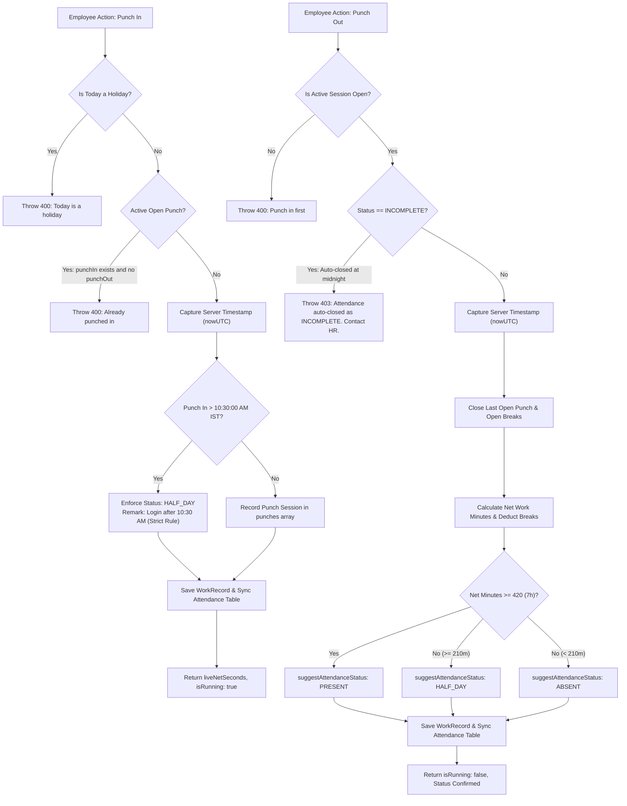
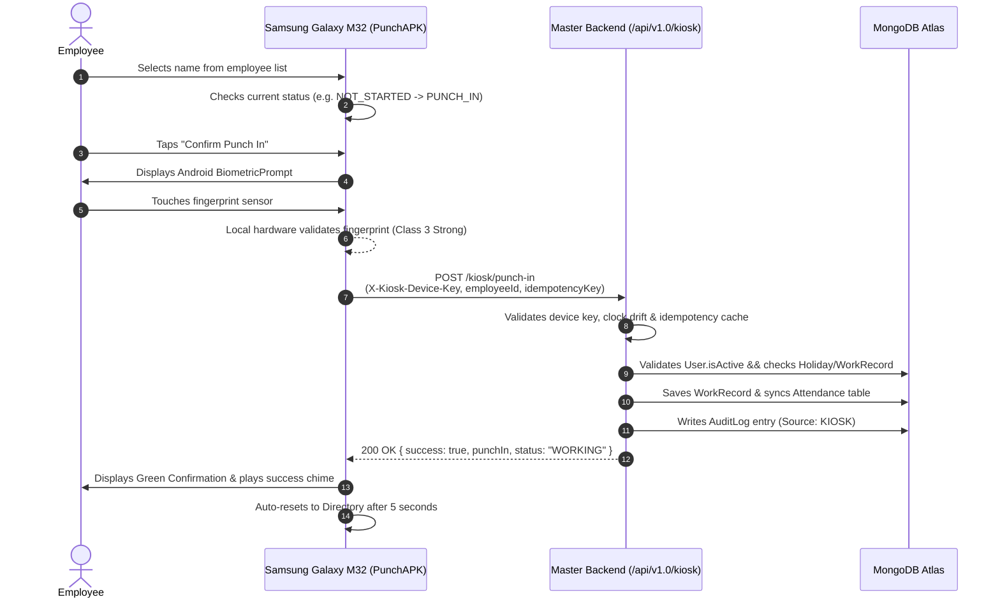
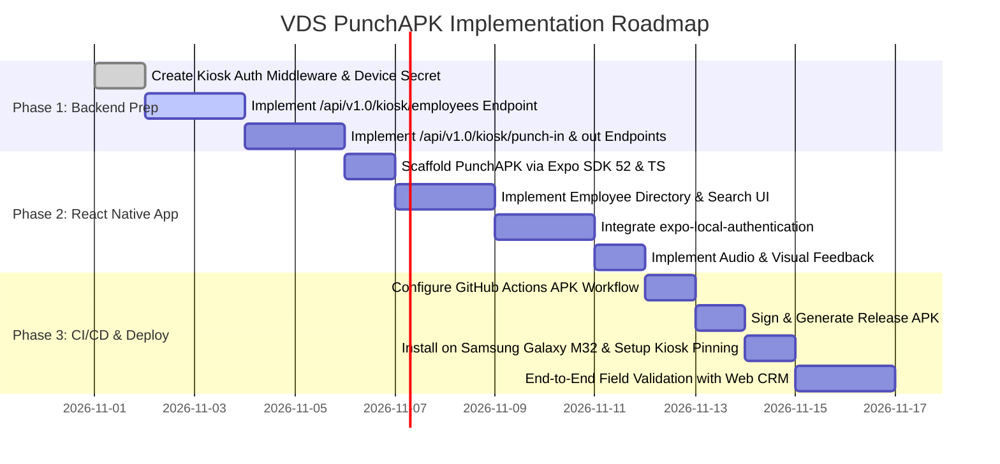

# VDS PunchAPK — Technical Feasibility and Integration Audit

**Target Platform:** Dedicated Android Attendance Kiosk (Samsung Galaxy M32)  
**Target Repository:** `d:\_VDS\VDS Softwares`  
**Inspected Components:** `Backend/` (Master Express/MongoDB API) and `VIDYACRM/` (Vite/React CRM Frontend)  
**Strictly Out of Scope Components:** `Client Portal/`, `QrServices/`, `Quotation/`  
**Audit Date:** October 2026  
**Auditor:** Senior Software Architect, MERN Stack, React Native & DevOps Engineering Team  

---

## 1. Executive Summary

This technical feasibility and integration audit assesses the architecture, code conventions, security parameters, and hardware requirements for introducing **VDS PunchAPK**—a dedicated React Native Android biometric attendance kiosk application running on a Samsung Galaxy M32.

### Key Audit Findings

1. **Backend Foundation (`Backend/`)**:
   - The master backend is an **Express 5.1.0** ES module (`"type": "module"`) server running on Node.js with **Mongoose 8.19.4** connected to MongoDB Atlas.
   - Entry point is `Backend/server.js`. Default API routing prefix is `/api/v1.0`.
   - Comprehensive attendance logic, policies, and schemas already exist in `Backend/StaffCRM/Attendance/`.
   - **Critical Architecture Gap**: The existing attendance endpoints (`punchIn`, `punchOut`, and `getTodayWorkRecord` in `attendance.controller.js`) strictly extract the user identity from `req.user.id` via personal user JWT tokens. They **do not accept an arbitrary employee identifier** in the request payload.
   - There is currently **no kiosk device authorization concept or dedicated kiosk API**. Running the kiosk against existing endpoints would require either storing all employee login credentials on the kiosk (an untenable security flaw) or adding dedicated kiosk endpoints.

2. **CRM Frontend Attendance Parity (`VIDYACRM/`)**:
   - Built on **React 19.2.0** and **Vite 7.2.4**. Attendance state is managed through a centralized custom hook `useAttendance.js` and displayed via `DailyTimer.jsx`.
   - Multi-session punching is fully supported: employees can punch in, punch out, and punch in again throughout the day (`punches` array on `WorkRecord`).
   - The strict **10:30 AM IST** cutoff is enforced: any punch-in occurring after 10:30:00 AM IST automatically marks attendance as `HALF_DAY`.
   - Midnight auto-close cron (`attendance.cron.js`) marks forgotten punch-outs as `INCOMPLETE`, blocking subsequent punch-outs without HR override.

3. **Hardware & Biometric Feasibility (Samsung Galaxy M32)**:
   - The Samsung Galaxy M32 features a side-mounted capacitive fingerprint sensor integrated with Android's `BiometricPrompt` API (Class 3 / Strong Biometric).
   - An **Expo Development Build** utilizing `expo-local-authentication` is completely compatible with this hardware.
   - **Crucial Security Reality**: Android's `BiometricPrompt` API is a **local 1:1 biometric verification gate, NOT an identification engine (1:N matcher)**. The hardware sensor determines only whether *a finger enrolled on that specific Samsung phone* unlocked the prompt. It **does not identify which employee scanned their finger**.
   - As a result, the proposed kiosk flow (Employee Name Selection → Fingerprint Prompt → Remote Server Punch) is a **supervised / honor-system kiosk**. One enrolled device user could physically select a coworker's name and scan their own finger. The backend must enforce server-authoritative timestamps, device-level token authentication, idempotency tokens, and rate limits to mitigate abuse.

4. **Recommended Implementation Path**:
   - Create a clean **Expo SDK 52+ / React Native** project in `PunchAPK/` with TypeScript and `expo-local-authentication`.
   - Introduce **dedicated Kiosk API endpoints** on the backend (`/api/v1.0/kiosk/*`) authenticated via a secure Kiosk Device API Secret and Device UUID, preserving 100% backward compatibility with the existing web CRM.
   - Automate standalone APK generation using **GitHub Actions Native Gradle builds** without ongoing cloud subscription dependencies.

---

## 2. Repository Structure & Relevant File Map

```
d:\_VDS\VDS Softwares\
├── Backend/                              # [IN SCOPE] Master Express/Node.js API
│   ├── config/
│   │   ├── cors.config.js               # CORS domain rules & mobile exception
│   │   ├── cron.config.js               # Scheduled background jobs
│   │   ├── db.config.js                 # MongoDB Atlas connection (1.1.1.1 DNS)
│   │   └── ip.config.js                 # Local LAN IP detection utility
│   ├── StaffCRM/
│   │   ├── Attendance/
│   │   │   ├── attendance.controller.js # Punch, work record, status handlers
│   │   │   ├── attendance.model.js      # Attendance daily status model
│   │   │   ├── attendance.routes.js     # /api/v1.0/attendance router
│   │   │   ├── attendance.service.js    # Core attendance calculation engine
│   │   │   ├── weeklyWork.model.js      # Weekly 48-hr progress tracking model
│   │   │   ├── workPolicy.js            # Office hours, thresholds (420m / 210m)
│   │   │   ├── workRecord.model.js      # Punches, breaks, live net minutes model
│   │   │   ├── cron/
│   │   │   │   └── attendance.cron.js   # Midnight auto-close (INCOMPLETE status)
│   │   │   └── utils/
│   │   │       └── attendance.utils.js  # IST time normalization, 10:30 AM rule
│   │   ├── AuditLog/                    # Action audit logging system
│   │   ├── Holidays/                    # Holiday model & services
│   │   ├── Leaves/                      # Leave model & half-day validation
│   │   ├── middleware/
│   │   │   ├── auth.middleware.js       # JWT bearer token verification (`protect`)
│   │   │   └── role.middleware.js       # Role & custom permission guards
│   │   ├── Users/
│   │   │   ├── user.controller.js       # Login, profile, employee list
│   │   │   ├── user.model.js            # Employee schema & indexes
│   │   │   ├── user.routes.js           # /api/v1.0/users router
│   │   │   └── user.service.js          # User queries & role sorting
│   │   └── utils/
│   │       └── jwt.util.js              # Token signing & verification (30d expiry)
│   ├── package.json                     # Express 5.1.0, Mongoose 8.19.4, JWT
│   └── server.js                        # Master HTTP entry point & port binding
│
├── VIDYACRM/                             # [IN SCOPE] Primary Web CRM
│   ├── src/
│   │   ├── api/
│   │   │   ├── attendance.api.js        # Axios attendance endpoints
│   │   │   ├── auth.api.js              # Profile & login requests
│   │   │   └── axios.js                 # Axios client, baseURL, auth interceptor
│   │   ├── components/
│   │   │   ├── Attendance/
│   │   │   │   └── AttendanceCalendar.jsx # Monthly calendar view
│   │   │   ├── DailyTimer/
│   │   │   │   ├── DailyTimer.jsx       # Circular timer, Punch In/Out/Break UI
│   │   │   │   └── DailyTimer.module.css
│   │   │   └── TopHeader/               # Header bar
│   │   ├── context/
│   │   │   └── AuthContext.jsx          # User state, employee list, token storage
│   │   ├── hooks/
│   │   │   └── useAttendance.js         # Reducer, live ticking, sync logic
│   │   ├── pages/
│   │   │   └── Employee/
│   │   │       └── EmployeeAttendance.jsx # Employee attendance screen
│   │   ├── App.jsx                      # Route definitions
│   │   └── main.jsx                     # Vite mount
│   └── package.json                     # React 19.2.0, Vite 7.2.4
│
├── Client Portal/                        # [STRICTLY OUT OF SCOPE — UNTOUCHED]
├── QrServices/                           # [STRICTLY OUT OF SCOPE — UNTOUCHED]
├── Quotation/                            # [STRICTLY OUT OF SCOPE — UNTOUCHED]
└── PunchAPK/                             # [TARGET DIRECTORY FOR MOBILE APPLICATION]
    └── PUNCHAPK_TECHNICAL_AUDIT.md       # Technical audit report
```

---

## 3. Existing Backend Architecture

### 3.1 Framework, Entry Point, and Network Binding
- **Framework:** Express `^5.1.0` configured as native ECMAScript Modules (`"type": "module"`).
- **Entry Point:** `Backend/server.js`.
- **Port & Address Binding:** Configured in `server.js` (lines 48, 153–161):
  ```javascript
  const PORT = process.env.PORT || 5000;
  const VERSION = process.env.VERSION || "v1.0";
  app.listen(PORT, "0.0.0.0", () => { ... });
  ```
  Binding to `"0.0.0.0"` ensures the backend is accessible over local Wi-Fi / LAN at `http://<LAN_IP>:5000/api/v1.0` and can be placed behind an HTTPS reverse proxy (such as Nginx, Cloudflare, or AWS ALB).
- **Public HTTPS Exposure:** The backend does not implement TLS termination in Node.js. In production, HTTPS must be terminated by an external ingress or reverse proxy. Android apps will require valid TLS or an explicit Android network security exemption.

### 3.2 Request Pipeline and Global Middleware
Mounted in `Backend/server.js`:
1. **CORS:** `app.use(cors("*"))` allows requests across origins. In addition, `Backend/config/cors.config.js` includes `if (!origin) return callback(null, true);`, explicitly accommodating mobile apps and Postman clients that omit the browser `Origin` header.
2. **Payload Parsing:** `express.json({ limit: "100mb" })` and `express.urlencoded({ extended: true, limit: "100mb" })`.
3. **Request Tracing:** Generates `req.requestId = crypto.randomUUID()` and logs incoming requests.
4. **Error Handling:** Centralized `globalErrorHandler` converting `AppError` instances into uniform JSON error envelopes: `{ success: false, message: "..." }`.

### 3.3 Database Architecture
- **Engine:** MongoDB Atlas via Mongoose `^8.19.4`.
- **Connection Logic (`db.config.js`):**
  - Sets DNS resolvers explicitly to `1.1.1.1` and `8.8.8.8` to circumvent Windows MongoDB SRV resolution issues.
  - Assembles URI from environment variables: `MONGO_USER`, `MONGO_PASS`, `MONGO_CLUSTER`, `MONGO_DB`.
  - Configures `serverSelectionTimeoutMS: 10000`.

### 3.4 Authentication & Authorization Subsystem
- **JWT Implementation (`jwt.util.js`):** Tokens signed using `process.env.JWT_SECRET` with 30-day expiration (`expiresIn: "30d"`).
- **Authentication Middleware (`auth.middleware.js`):**
  - Extracts `Authorization: Bearer <token>`.
  - Decodes token, verifies `decoded.id`, queries database: `await User.findById(decoded.id).lean()`.
  - Rejects request if user does not exist or `user.isActive === false`.
  - Populates `req.user = user` and `req.user.id = user._id.toString()`.
- **Role Middleware (`role.middleware.js`):**
  - Checks role membership against allowed roles: `admin`, `administrative`, `hr`, `employee`, `intern`.
  - Role `"administrative"` possesses super-admin bypass privilege.

---

## 4. Existing CRM Attendance Implementation

### 4.1 Attendance Data Models

The system maintains two tightly coupled Mongoose models to represent attendance events:

#### 1. `Attendance` (`Backend/StaffCRM/Attendance/attendance.model.js`)
Represents the official, normalized daily status for payroll, reports, and calendar displays:
- `user`: `mongoose.Schema.Types.ObjectId`, ref `"User"`, required.
- `date`: `Date`, normalized to IST midnight stored in UTC.
- `status`: Enum `["PRESENT", "HALF_DAY", "ABSENT", "WFH", "HOLIDAY", "LEAVE", "INCOMPLETE"]`, default `"ABSENT"`.
- `source`: Enum `["SYSTEM", "HR", "ADMIN"]`, default `"SYSTEM"`.
- `remarks`: `String` (e.g., auto-half-day notes or manual override descriptions).
- Compound Unique Index: `{ user: 1, date: 1 }` (strictly prevents duplicate daily status rows per user).

#### 2. `WorkRecord` (`Backend/StaffCRM/Attendance/workRecord.model.js`)
Represents the high-resolution, operational time tracking for the day:
- `user`: `mongoose.Schema.Types.ObjectId`, ref `"User"`, required.
- `date`: `Date` (IST normalized, stored in UTC).
- `punchIn`: `Date` (initial punch-in timestamp of the day).
- `punchOut`: `Date` (most recent punch-out timestamp).
- `punches`: Array of `{ in: Date, out: Date }` (multi-session audit log).
- `breaks`: Array of `{ in: Date, out: Date }`.
- `totalWorkMinutes`, `totalBreakMinutes`, `netWorkMinutes`: Capped numerical values.
- `lateMinutes`, `overtimeMinutes`: Calculated offsets against shift policies.
- `attendanceStatus`: Mirrors the `Attendance` model status.
- `reportSubmitted`: `Boolean`, default `false`.
- `autoClosed`: `Boolean`, default `false`.
- Compound Unique Index: `{ user: 1, date: 1 }`.

### 4.2 Business Logic & Calculation Rules

The business logic in `Backend/StaffCRM/Attendance/attendance.service.js` and `attendance.utils.js` governs punch workflows:



#### Detailed Rule Breakdown:
1. **Multi-Session Punching:** Employees can punch in and out multiple times per day. When punching out, `record.punchOut = now` and the open punch in `punches` receives `out = now`. When punching in again, the backend executes `$unset: { punchOut: 1 }`, leaves the initial `record.punchIn` untouched, and appends a new `{ in: now, out: null }` object to `record.punches`.
2. **Strict 10:30 AM Cutoff (`isPunchInAfter1030IST`):** Evaluates whether the timestamp in IST exceeds `37800` seconds (10:30:00 AM). If true, the employee is automatically assigned `HALF_DAY`, regardless of total hours worked later in the day.
3. **Thresholds (`workPolicy.js`):**
   - Standard employees / HR: Daily requirement = 8 hours. Present threshold = 420 minutes (7 net hours + 1 hr break). Half-day threshold = 210 minutes (3.5 net hours). Max daily cap = 480 minutes.
   - Interns: Daily requirement = 5 hours (4 work + 1 break). Present threshold = 240 minutes (4 net hours). Half-day threshold = 120 minutes. Max daily cap = 300 minutes.
4. **Midnight Auto-Close Cron (`0 0 * * *`):** Scans for open work records from yesterday. Caps punch-out to 8 hours from punch-in, marks `autoClosed: true`, and updates the `Attendance` document to `status: "INCOMPLETE"`. Once marked `INCOMPLETE`, normal punch-out is blocked with `403 Forbidden`, requiring HR override.
5. **Daily Report Guard in CRM:** In the web CRM frontend (`useAttendance.js`), `punchOut` checks `if (!state.reportSubmitted)` and alerts the user. However, **this check is frontend-only**; the backend `punchOutService` does not reject punch-outs if `reportSubmitted === false`.

---

## 5. API Inventory with Actual Source References

The following table itemizes every existing endpoint in the master backend relevant to the attendance lifecycle:

| HTTP Method | Route Path | Purpose | Request Payload | Auth / Roles | Source File Location | Direct Reusability for Kiosk | Limitations & Security Concerns |
| :--- | :--- | :--- | :--- | :--- | :--- | :--- | :--- |
| `POST` | `/api/v1.0/users/login` | User authentication & JWT issuance | `{ email, password }` | Public | `user.routes.js:24` | ❌ No | Requires individual user password. Cannot be used by an employee kiosk without storing passwords. |
| `GET` | `/api/v1.0/users` | List all active employees | None | `protect` (Any active user role) | `user.routes.js:31` | ⚠️ Partial | Requires a valid user JWT. Returns full user objects (sans password). Unauthenticated kiosk cannot call this. |
| `GET` | `/api/v1.0/attendance/work-record/today` | Fetch today's work record & timer state | None | `protect` (Extracts `req.user.id`) | `attendance.routes.js:15` | ❌ No | **Hardcoded to `req.user.id`**. Cannot fetch the state of an arbitrary employee selected on a kiosk. |
| `POST` | `/api/v1.0/attendance/punch-in` | Punch in current user | None | `protect` (Extracts `req.user.id`) | `attendance.routes.js:16` | ❌ No | **Hardcoded to `req.user.id`**. Does not accept `employeeId` in payload. Cannot be used by a shared kiosk. |
| `POST` | `/api/v1.0/attendance/punch-out` | Punch out current user | None | `protect` (Extracts `req.user.id`) | `attendance.routes.js:17` | ❌ No | **Hardcoded to `req.user.id`**. Does not accept `employeeId` in payload. Cannot be used by a shared kiosk. |
| `GET` | `/api/v1.0/attendance/live-status/date` | Live attendance status of all employees | Query: `?date=YYYY-MM-DD` | `protect` + `roleCheck("admin", "hr")` | `attendance.routes.js:43` | ⚠️ Partial | Restricted to `admin` / `hr`. Returns exactly the status badges needed (`NOT_STARTED`, `WORKING`, `ON_BREAK`, `COMPLETED`), but requires high-privilege credentials. |
| `GET` | `/api/v1.0/attendance/work-record/by-date` | Specific employee work record by date | Query: `?userId=...&date=...` | `protect` + `roleCheck("admin", "hr")` | `attendance.routes.js:59` | ⚠️ Partial | Restricted to `admin` / `hr`. Requires `userId` and `date`. High-privilege requirement is unsuitable for an untrusted device. |
| `POST` | `/api/v1.0/kiosk/punch-in` | Dedicated kiosk punch-in | `{ employeeId, deviceId }` | `NOT FOUND` | N/A | ❌ Needs Implementation | Does not exist in current codebase. |
| `POST` | `/api/v1.0/kiosk/punch-out` | Dedicated kiosk punch-out | `{ employeeId, deviceId }` | `NOT FOUND` | N/A | ❌ Needs Implementation | Does not exist in current codebase. |
| `GET` | `/api/v1.0/kiosk/employees` | Kiosk employee directory & status | Query: `?date=YYYY-MM-DD` | `NOT FOUND` | N/A | ❌ Needs Implementation | Does not exist in current codebase. |

---

## 6. Employee Identification & Attendance Data Model Analysis

### 6.1 Employee Identifier Mapping
- In `Backend/StaffCRM/Users/user.model.js`, employees **do not possess a legacy string `employeeId`** (such as `"EMP-001"`).
- The universal identifier throughout the entire backend ecosystem (`User`, `Attendance`, `WorkRecord`, `WeeklyWork`, `Leave`, `Task`, `AuditLog`) is strictly the MongoDB `_id` (`mongoose.Schema.Types.ObjectId`).
- When VIDYACRM references an employee, it passes `u._id` (e.g. `"654abc1234567890abcdef12"`).
- **Recommendation for PunchAPK:** The mobile app must treat the MongoDB hexadecimal `_id` string as `employeeId`. Introducing an artificial second ID would disrupt database relations.

### 6.2 Data Model Synchronization
When an attendance event occurs, two database records must stay synchronized:
1. `WorkRecord`: Records exact punch times, computes net worked seconds, and tallies session splits.
2. `Attendance`: Persists the coarse-grained daily state (`PRESENT`, `HALF_DAY`, `ABSENT`).
Both models use compound unique indexes on `{ user: 1, date: 1 }`. This guarantees that an employee cannot have duplicate attendance rows on any given calendar date.

---

## 7. Integration Gaps & Missing APIs

To deploy the Samsung Galaxy M32 kiosk without compromising security or degrading CRM stability, the following architectural gaps must be addressed:

```
┌─────────────────────────────────────────────────────────────────────────────┐
│                           INTEGRATION GAP MATRIX                            │
├──────────────────────┬────────────────────────────┬─────────────────────────┤
│ Required Capability  │ Current Repository State   │ Solution Requirement    │
├──────────────────────┼────────────────────────────┼─────────────────────────┤
│ 1. Kiosk Device      │ Only user JWTs supported;  │ Device API Key / Kiosk  │
│    Authentication    │ no device concept exists   │ Token middleware        │
├──────────────────────┼────────────────────────────┼─────────────────────────┤
│ 2. Third-Party Punch │ punchIn / punchOut use     │ Parameterized endpoints:│
│    Action            │ req.user.id exclusively    │ /api/v1.0/kiosk/punch-* │
├──────────────────────┼────────────────────────────┼─────────────────────────┤
│ 3. Kiosk Employee    │ GET /users requires user   │ Dedicated sanitized     │
│    Directory API     │ JWT; exposes personal data │ kiosk employee list     │
├──────────────────────┼────────────────────────────┼─────────────────────────┤
│ 4. Single-Employee   │ /work-record/today is      │ Kiosk employee status   │
│    Live Status       │ user-scoped; HR route is   │ query endpoint          │
│                      │ role-gated                 │                         │
├──────────────────────┼────────────────────────────┼─────────────────────────┤
│ 5. Network Protocol  │ Default HTTP on port 5000; │ HTTPS domain / reverse  │
│    Cleartext Trap    │ Android blocks HTTP        │ proxy or config XML     │
└──────────────────────┴────────────────────────────┴─────────────────────────┘
```

---

## 8. Biometric Feasibility & Security Limitations

### 8.1 Hardware & OS Analysis (Samsung Galaxy M32)
- **Model:** Samsung Galaxy M32 (SM-M325F / SM-M326B).
- **Biometric Sensor:** Capacitive fingerprint scanner mounted flush inside the side power key.
- **Android Versions:** Shipped with Android 11 (One UI 3.1); upgradable to Android 12 / Android 13 (One UI 5.0).
- **Biometric Class:** Android classifies Samsung's capacitive side sensor as **Class 3 (Strong)**, permitting cryptographic operations and local authentication keys.

### 8.2 The Critical Biometric Identity Limitation

> [!WARNING]
> **CRITICAL SECURITY DISCLOSURE: Biometric Verification vs. Biometric Identification**
> 
> The proposed kiosk workflow is:
> 1. Select employee name from a list.
> 2. Present device fingerprint prompt.
> 3. Send punch request to backend upon fingerprint success.
> 
> **Android’s `BiometricPrompt` performs 1:1 local device verification, NOT 1:N identity recognition.**
> 
> - The OS prompt returns a boolean: `{ success: true }` or `{ success: false }`.
> - The sensor verifies that **a fingerprint matching an enrolled template on that Samsung device** was detected.
> - **Android does NOT reveal whose fingerprint was scanned, which finger touched the sensor, or any biometric template identifier.**
> - If Employee A, Employee B, and the Office Manager all have fingerprints enrolled on the phone, **Employee A can select Employee B's name, scan Employee A's finger, and the device will report `success: true`.**
> 
> Therefore: **Device biometric authentication is proof of local physical authorization, NOT proof of the selected employee's identity.**

### 8.3 Security Countermeasures & Mitigations
To maintain audit integrity under these hardware constraints:
1. **Enforce `disableDeviceFallback: true`:** By default, Android prompts allow device PIN/Pattern fallback if the biometric scan fails. Disabling fallback prevents employees from punching with the tablet PIN.
2. **Kiosk Enrollment Policy:** Only the dedicated Office Admin or designated HR supervisor should enroll biometrics on the phone, OR the device should be locked under Samsung Knox / Android Lock Task Mode with a restricted enrollment set.
3. **Kiosk Device Signing Secret:** The tablet must authenticate to the backend using a cryptographically random device secret (`X-Kiosk-Secret`) provisioned during installation.
4. **Idempotency & Replay Protection:** Each punch request must include an `idempotencyKey` (`UUIDv4`) and a client timestamp. The backend verifies that the timestamp is within ±3 minutes of server time and rejects replayed keys.
5. **Audit Trail Logging:** All kiosk punch events must be categorized in `AuditLog` as `Source: "KIOSK"` with device ID and client metadata.

---

## 9. Recommended React Native / Expo Architecture

### 9.1 Framework Comparison

| Dimension | Expo Development Build (Recommended) | Bare React Native |
| :--- | :--- | :--- |
| **Biometric Integration** | `expo-local-authentication` (pre-tested Android BiometricPrompt wrapper) | `react-native-biometrics` (requires custom Gradle wiring) |
| **Build Reproducibility** | Configured via `app.json` + Expo Config Plugins; reproducible across machines | Vulnerable to local Android SDK / Gradle environment discrepancies |
| **CI/CD Automation** | Seamless headless build via `npx expo prebuild` + `./gradlew assembleRelease` | Requires manual maintenance of `android/` directory and build scripts |
| **Kiosk Capabilities** | Compatible with `expo-keep-awake`, immersive mode, and lock plugins | Full native Android access (requires custom Java/Kotlin maintenance) |
| **Maintenance Burden** | Low; automated upgrades via Expo CLI | High; native dependency link rot during React Native upgrades |

**Recommendation:** Adopt **Expo SDK 52+ with TypeScript**, using an **Expo Development Build (`expo-dev-client`)** and `expo-local-authentication`.

### 9.2 Key Packages & Native Configuration
- `expo`: `~52.0.0`
- `expo-local-authentication`: `~15.0.0` (biometric prompt and hardware detection)
- `expo-keep-awake`: Keeps the kiosk screen illuminated during office hours
- `expo-secure-store`: Stores the kiosk device API secret in Android KeyStore
- `@tanstack/react-query`: Server-state caching, background polling, and optimistic updates
- `axios`: HTTP client with timeout and interceptor configuration
- `react-native-safe-area-context`: Tablet layout boundary handling

### 9.3 App Lifecycle & Kiosk Mode Execution
- **Android Immersive Mode:** Configured in `app.json` under `android.package` to suppress Android navigation bars.
- **Screen Pinning / Lock Task Mode:** The app can be pinned using Android’s native Screen Pinning (Settings → Security → App Pinning) or enrolled in Android Enterprise Dedicated Device (COSU) mode to prevent employees from exiting to the home screen.
- **Auto-Reset Inactivity Watchdog:** A 30-second countdown timer automatically resets the screen to the idle employee directory if an employee taps their name but walks away without completing biometric verification.

---

## 10. Proposed PunchAPK Folder Structure

The following folder layout is recommended for the future `PunchAPK/` project directory:

```
PunchAPK/
├── .github/
│   └── workflows/
│       └── build-apk.yml               # GitHub Actions APK build workflow
├── assets/
│   ├── icon.png                        # App launcher icon (1024x1024)
│   ├── adaptive-icon.png               # Android adaptive icon foreground
│   ├── splash.png                      # Kiosk boot splash screen
│   └── sounds/                         # Chime sounds (success.mp3, error.mp3)
├── src/
│   ├── api/
│   │   ├── client.ts                   # Axios client instance with base URL & interceptors
│   │   ├── kiosk.api.ts                # Kiosk endpoint calls (fetchEmployees, punchIn, punchOut)
│   │   └── types.ts                    # TypeScript interfaces for requests & responses
│   ├── components/
│   │   ├── common/
│   │   │   ├── Button.tsx              # Primary kiosk touch buttons
│   │   │   ├── Header.tsx              # Kiosk clock & connection status header
│   │   │   └── SearchBar.tsx           # Employee search filter input
│   │   ├── kiosk/
│   │   │   ├── EmployeeCard.tsx        # Avatar, name, role, live status badge
│   │   │   ├── StatusBadge.tsx         # Working / Out / Break status pill
│   │   │   └── ConfirmationModal.tsx   # Action confirmation modal (Punch In vs Punch Out)
│   │   └── feedback/
│   │       ├── SuccessOverlay.tsx      # Full-screen green success confirmation
│   │       └── ErrorOverlay.tsx        # Actionable red error banner
│   ├── config/
│   │   └── env.ts                      # Validated environment configuration (API_URL, DEVICE_ID)
│   ├── hooks/
│   │   ├── useBiometrics.ts            # expo-local-authentication hook with fallback guards
│   │   ├── useKioskEmployees.ts        # React Query hook for employee list & status polling
│   │   ├── useNetworkStatus.ts         # Connectivity watchdog
│   │   └── useIdleReset.ts             # 30-second user inactivity reset timer
│   ├── navigation/
│   │   └── RootNavigator.tsx           # Screen navigation (Kiosk Screen, Settings Modal)
│   ├── screens/
│   │   ├── KioskScreen.tsx             # Primary kiosk interface
│   │   └── SetupScreen.tsx             # Initial device pairing & API secret enrollment
│   ├── services/
│   │   ├── biometric.service.ts        # Hardware check, prompt trigger, error parsing
│   │   └── storage.service.ts          # expo-secure-store wrappers for device credentials
│   └── types/
│       └── index.ts                    # Global shared types (Employee, PunchRecord, Session)
├── .env.example                        # Template for local dev (EXPO_PUBLIC_API_URL)
├── .gitignore                          # Excludes node_modules, android/, .expo/, *.apk
├── app.json                            # Expo application configuration & plugins
├── babel.config.js                     # Babel presets
├── package.json                        # App manifest & dependencies
├── tsconfig.json                       # TypeScript compiler configuration
└── PUNCHAPK_TECHNICAL_AUDIT.md         # THIS REPORT
```

### Git Exclusion Rules (`PunchAPK/.gitignore`)
```gitignore
node_modules/
.expo/
dist/
android/
ios/
*.apk
*.aab
*.jks
*.keystore
.env
.env.local
```

---

## 11. API Recommendations for Missing Functionality

To integrate the kiosk cleanly without modifying existing CRM web endpoints, the following new endpoints should be introduced under `/api/v1.0/kiosk/` on the master backend:

### Endpoint 1: Fetch Kiosk Directory & Live Attendance
- **Method:** `GET`
- **Route:** `/api/v1.0/kiosk/employees`
- **Headers:** `X-Kiosk-Device-Key: <DEVICE_SECRET>`
- **Response Structure (200 OK):**
```json
{
  "success": true,
  "serverTime": "2026-10-29T13:30:00.000Z",
  "employees": [
    {
      "id": "671234567890abcdef123456",
      "name": "Alex Johnson",
      "designation": "Video Editor",
      "role": "employee",
      "profilePicture": "https://res.cloudinary.com/.../avatar.jpg",
      "status": "WORKING",
      "punchIn": "2026-10-29T04:30:00.000Z",
      "punchOut": null,
      "nextAllowedAction": "PUNCH_OUT"
    },
    {
      "id": "671234567890abcdef123457",
      "name": "Priya Sharma",
      "designation": "Graphic Designer",
      "role": "employee",
      "profilePicture": null,
      "status": "NOT_STARTED",
      "punchIn": null,
      "punchOut": null,
      "nextAllowedAction": "PUNCH_IN"
    }
  ]
}
```

### Endpoint 2: Execute Kiosk Punch In
- **Method:** `POST`
- **Route:** `/api/v1.0/kiosk/punch-in`
- **Headers:** `X-Kiosk-Device-Key: <DEVICE_SECRET>`
- **Request Payload:**
```json
{
  "employeeId": "671234567890abcdef123457",
  "deviceId": "M32-KIOSK-RECEPTION-01",
  "idempotencyKey": "a8b7c6d5-e4f3-4210-9876-543210fedcba",
  "clientTimestamp": "2026-10-29T13:31:00.000Z"
}
```
- **Backend Validation & Processing:**
  1. Verify `X-Kiosk-Device-Key` matches configured kiosk secrets.
  2. Validate `clientTimestamp` is within 3 minutes of server time.
  3. Validate `employeeId` exists and `isActive: true`.
  4. Invoke `punchInService(employeeId)`.
  5. Log activity in `AuditLog` as `KIOSK_PUNCH_IN`.
- **Response Structure (200 OK):**
```json
{
  "success": true,
  "message": "Punch in successful. Have a great day!",
  "data": {
    "employeeId": "671234567890abcdef123457",
    "punchIn": "2026-10-29T13:31:02.145Z",
    "status": "WORKING",
    "isLateHalfDay": false
  }
}
```

### Endpoint 3: Execute Kiosk Punch Out
- **Method:** `POST`
- **Route:** `/api/v1.0/kiosk/punch-out`
- **Headers:** `X-Kiosk-Device-Key: <DEVICE_SECRET>`
- **Request Payload:**
```json
{
  "employeeId": "671234567890abcdef123456",
  "deviceId": "M32-KIOSK-RECEPTION-01",
  "idempotencyKey": "f1e2d3c4-b5a6-4789-0123-456789abcdef",
  "clientTimestamp": "2026-10-29T18:05:00.000Z"
}
```
- **Backend Validation & Processing:**
  1. Verify kiosk credentials and idempotency key.
  2. Invoke `punchOutService(employeeId)`.
  3. Calculate net minutes and synchronize `Attendance` document.
  4. Log activity in `AuditLog` as `KIOSK_PUNCH_OUT`.
- **Response Structure (200 OK):**
```json
{
  "success": true,
  "message": "Punch out successful. Great work today!",
  "data": {
    "employeeId": "671234567890abcdef123456",
    "punchIn": "2026-10-29T04:30:00.000Z",
    "punchOut": "2026-10-29T18:05:02.321Z",
    "totalWorkMinutes": 540,
    "netWorkMinutes": 480,
    "attendanceStatus": "PRESENT"
  }
}
```

---

## 12. Backend Security & Device Authorization



### Security Policy Checklist
1. **Device Secret Management:**
   - Define `KIOSK_DEVICE_KEYS` in the backend environment as a comma-separated list of approved device tokens or implement a `KioskDevice` collection storing hashed keys.
   - The device secret must never be hardcoded into the mobile source; it must be provisioned during setup and stored in `expo-secure-store`.
2. **Server-Generated Timestamps:**
   - Under no circumstances should the server use the phone's clock for attendance calculations. The server executes `nowUTC()` upon validating the request.
3. **Idempotency & Double-Tap Protection:**
   - Use an in-memory or Redis LRU cache on the backend caching `idempotencyKey` values for 10 minutes to prevent duplicate attendance events from network retries.
4. **Rate Limiting:**
   - Apply strict rate limiting (`express-rate-limit`) on `/api/v1.0/kiosk/*`: maximum 30 requests per minute per IP address.

---

## 13. GitHub Actions APK Build Strategy

A standalone Android release APK should be generated via a GitHub Actions workflow using native Gradle builds inside the runner. This avoids ongoing EAS cloud credit fees and provides rapid build cycles.

### 13.1 Proposed GitHub Actions Workflow (`PunchAPK/.github/workflows/build-apk.yml`)

```yaml
name: Build VDS PunchAPK Android Release

on:
  push:
    paths:
      - 'PunchAPK/**'
    branches:
      - main
  workflow_dispatch:

jobs:
  build-android:
    name: Build Android APK
    runs-on: ubuntu-latest
    defaults:
      run:
        working-directory: PunchAPK

    steps:
      - name: Checkout Code
        uses: actions/checkout@v4

      - name: Set up Java JDK 17
        uses: actions/setup-java@v4
        with:
          distribution: 'zulu'
          java-version: '17'

      - name: Set up Node.js 20
        uses: actions/setup-node@v4
        with:
          node-version: 20
          cache: 'npm'
          cache-dependency-path: PunchAPK/package-lock.json

      - name: Install Dependencies
        run: npm ci

      - name: Generate Android Project via Expo Prebuild
        run: npx expo prebuild --platform android --clean
        env:
          EXPO_PUBLIC_API_URL: ${{ secrets.EXPO_PUBLIC_API_URL }}

      - name: Decode Android Keystore
        if: env.ANDROID_KEYSTORE_BASE64 != ''
        run: |
          echo "${{ secrets.ANDROID_KEYSTORE_BASE64 }}" | base64 --decode > android/app/release.keystore
        env:
          ANDROID_KEYSTORE_BASE64: ${{ secrets.ANDROID_KEYSTORE_BASE64 }}

      - name: Build Release APK via Gradle
        working-directory: PunchAPK/android
        run: ./gradlew assembleRelease --no-daemon
        env:
          ANDROID_KEYSTORE_PASSWORD: ${{ secrets.ANDROID_KEYSTORE_PASSWORD }}
          ANDROID_KEY_ALIAS: ${{ secrets.ANDROID_KEY_ALIAS }}
          ANDROID_KEY_PASSWORD: ${{ secrets.ANDROID_KEY_PASSWORD }}

      - name: Upload APK Artifact
        uses: actions/upload-artifact@v4
        with:
          name: vds-punch-kiosk-release-${{ github.run_number }}
          path: PunchAPK/android/app/build/outputs/apk/release/app-release.apk
          retention-days: 30
```

### 13.2 Required GitHub Repository Secrets (By Name & Purpose)
- `EXPO_PUBLIC_API_URL`: The production or staging HTTPS API base URL (e.g. `https://backend.vidyadigitalstudio.com/api/v1.0`).
- `ANDROID_KEYSTORE_BASE64`: Base64-encoded standard Java Keystore (`.jks` / `.keystore`) file.
- `ANDROID_KEYSTORE_PASSWORD`: Keystore master password.
- `ANDROID_KEY_ALIAS`: Private signing key alias name.
- `ANDROID_KEY_PASSWORD`: Private signing key password.

---

## 14. Testing Strategy

1. **Unit Testing:**
   - Mock `expo-local-authentication` to verify prompt cancellation, failure, and success states.
   - Verify `useIdleReset` timer resets employee selection precisely after 30 seconds.
   - Verify timestamp drift rejection on kiosk endpoints.
2. **Device Hardware Testing (Samsung Galaxy M32):**
   - Test fingerprint scanning responsiveness on side power key.
   - Verify prompt behavior with clean, wet, and unregistered fingers.
   - Verify that cancelling the prompt returns cleanly to the employee selection view without freezing.
   - Verify `disableDeviceFallback: true` blocks Android PIN entry fallback.
3. **Network Boundary Testing:**
   - Simulate Wi-Fi dropouts during punch transmission; verify appropriate timeout alerts and idempotency preservation.
   - Test offline detection banner when kiosk Wi-Fi is disconnected.
4. **End-to-End Regression Testing:**
   - Punch in via kiosk → inspect `WorkRecord` in MongoDB Atlas → verify live timer updates simultaneously on the VIDYACRM web dashboard for that user.
   - Punch out via kiosk → verify daily summary and attendance status reflect immediately on the web CRM calendar.

---

## 15. Risks, Dependencies, and Assumptions

### Risks & Mitigations
- **Risk: Buddy Punching / Unverified Biometric Identity:**
  - *Reality:* Android biometrics do not distinguish between enrolled fingers.
  - *Mitigation:* The kiosk must be placed in a visible, supervised reception or studio area. Device PIN must be kept confidential by the administrator to prevent unauthorized fingerprint additions in Android Settings.
- **Risk: Android Cleartext Traffic Rejection:**
  - *Reality:* Android 9+ blocks HTTP. If testing over LAN (`http://192.168.x.x:5000`), requests will fail silently.
  - *Mitigation:* Configure an HTTPS reverse proxy (Nginx or Cloudflare Tunnel) or configure `android:networkSecurityConfig` for local development.
- **Risk: Kiosk Application Crash / Exit:**
  - *Reality:* Employees could accidentally close the app.
  - *Mitigation:* Utilize Android’s native Screen Pinning (Lock Task Mode) and configure `expo-keep-awake`.

### Dependencies & Assumptions
- The Samsung Galaxy M32 will remain connected to the studio Wi-Fi network.
- The master backend server remains the sole authority for attendance computation and timestamps.
- No modifications will be made to `Client Portal/`, `QrServices/`, or `Quotation/`.

---

## 16. Phased Implementation Plan



- **Phase 1: Backend Preparation (Non-Breaking Extensions)**
  - Implement `/api/v1.0/kiosk/*` routes in `Backend/StaffCRM/Kiosk/`.
  - Add kiosk device authentication middleware and audit logging tags.
- **Phase 2: Mobile Application Development (`PunchAPK/`)**
  - Scaffold project using Expo and TypeScript.
  - Build the searchable employee grid, biometric authentication service, and confirmation modals.
  - Connect API client to the backend kiosk endpoints.
- **Phase 3: Automated CI/CD & Sideloading**
  - Add GitHub Actions workflow `.github/workflows/build-apk.yml`.
  - Produce signed release APK.
  - Sideload onto the Samsung Galaxy M32, configure Screen Pinning, and conduct live attendance verification against VIDYACRM.

---

## 17. Final Recommendation & Implementation Readiness Checklist

### Final Architectural Recommendation
Proceed with an **Expo Development Build** application housed cleanly inside `PunchAPK/`, paired with **three purpose-built kiosk endpoints** on the master backend. This cleanly satisfies all business requirements, preserves existing web CRM stability, honors existing 10:30 AM and midnight attendance rules, and enforces server-authoritative timestamps without exposing employee passwords.

### Implementation Readiness Checklist
- [x] Repository structure audited and verified read-only.
- [x] Backend entry point, Mongoose schemas, and attendance calculation utilities traced.
- [x] Frontend attendance components and hooks cataloged.
- [x] Samsung Galaxy M32 biometric hardware limitations and capabilities evaluated.
- [x] GitHub Actions automated APK build strategy defined.
- [x] Report saved to `PunchAPK/PUNCHAPK_TECHNICAL_AUDIT.md`.
- [ ] **Awaiting User Approval to initiate Phase 1 implementation.**

